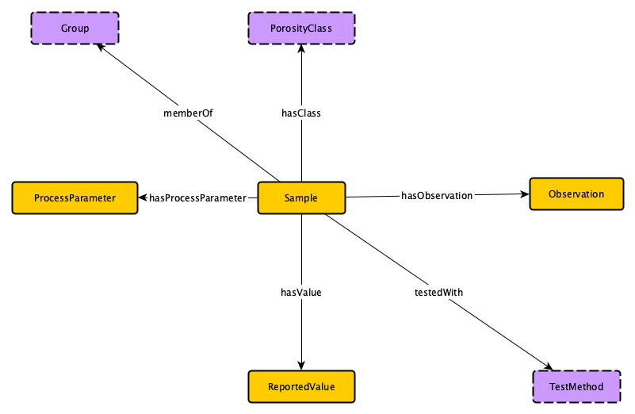
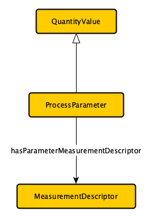
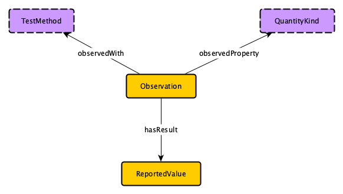
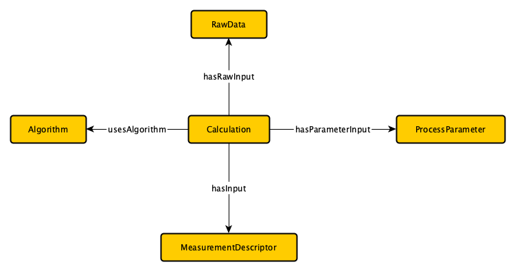
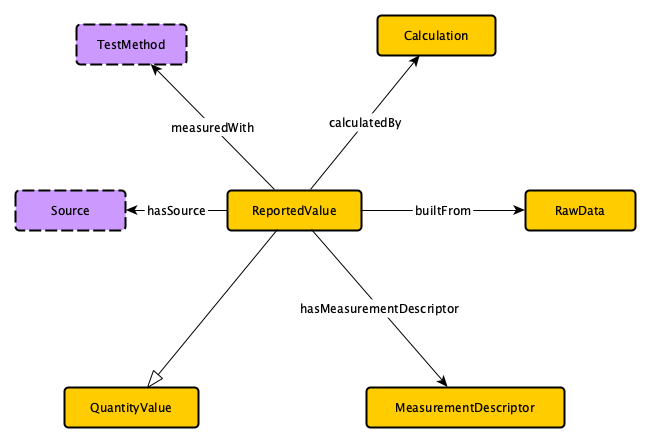
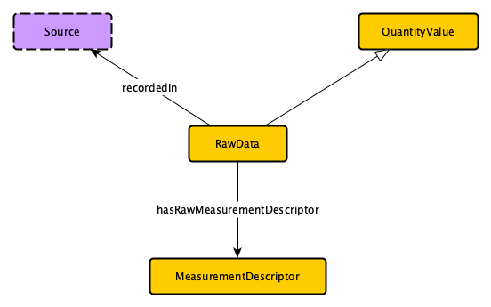
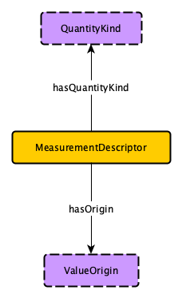
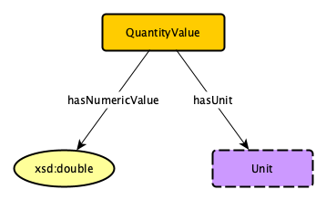

# Axioms
## Module 01 SPECIMEN & CLASSIFICATION
 
Classes: Group, Sample, PorosityClass
 

 
**Axioms**
 
### Sample hasClass PorosityClass
 
* disjoint: `Sample DisjointWith PorosityClass`
* domain: `hasClass some owl:Thing SubClassOf Sample`
* global range: `owl:Thing SubClassOf hasClass only PorosityClass`
* qualified scoped cardinality: `Sample SubClassOf hasClass max 1 PorosityClass`
  Sample has at most one (functionality) PorosityClass
### Sample hasObservation Observation
 
* disjoint: `Sample DisjointWith Observation`
* domain: `hasObservation some owl:Thing SubClassOf Sample`
* global range: `owl:Thing SubClassOf hasObservation only Observation`
* qualified scoped cardinality: `Sample SubClassOf hasObservation min 1 Observation`
  Sample has at least one Observation
* crosses to module: 03 OBSERVATION & METHOD
### Sample hasProcessParameter ProcessParameter
 
* disjoint: `Sample DisjointWith ProcessParameter`
* domain: `hasProcessParameter some owl:Thing SubClassOf Sample`
* global range: `owl:Thing SubClassOf hasProcessParameter only ProcessParameter`
* qualified scoped cardinality: `Sample SubClassOf hasProcessParameter min 1 ProcessParameter`
  Sample has at least one ProcessParameter
* crosses to module: 02 PROCESS SETTINGS
### Sample hasValue ReportedValue
 
* disjoint: `Sample DisjointWith ReportedValue`
* domain: `hasValue some owl:Thing SubClassOf Sample`
* global range: `owl:Thing SubClassOf hasValue only ReportedValue`
* qualified scoped cardinality: `Sample SubClassOf hasValue min 1 ReportedValue`
  Sample has at least one ReportedValue
* crosses to module: 05 REPORTED RESULT
### Sample memberOf Group
 
* disjoint: `Sample DisjointWith Group`
* domain: `memberOf some owl:Thing SubClassOf Sample`
* global range: `owl:Thing SubClassOf memberOf only Group`
* qualified scoped cardinality: `Sample SubClassOf memberOf exactly 1 Group`
  Sample has exactly one Group
### Sample testedWith TestMethod
 
* disjoint: `Sample DisjointWith TestMethod`
* domain: `testedWith some owl:Thing SubClassOf Sample`
* global range: `owl:Thing SubClassOf testedWith only TestMethod`
* qualified scoped cardinality: `Sample SubClassOf testedWith some TestMethod`
  Sample has at least one TestMethod
* crosses to module: 03 OBSERVATION & METHOD
## Module 02 PROCESS SETTINGS
 
Classes: ProcessParameter
 

 
**Axioms**
 
### ProcessParameter hasParameterMeasurementDescriptor MeasurementDescriptor
 
* disjoint: `ProcessParameter DisjointWith MeasurementDescriptor`
* domain: `hasParameterMeasurementDescriptor some owl:Thing SubClassOf ProcessParameter`
* global range: `owl:Thing SubClassOf hasParameterMeasurementDescriptor only MeasurementDescriptor`
* qualified scoped cardinality: `ProcessParameter SubClassOf hasParameterMeasurementDescriptor exactly 1 MeasurementDescriptor`
  ProcessParameter has exactly one MeasurementDescriptor
* crosses to module: 07 MEASUREMENT SEMANTICS
### ProcessParameter is a kind of QuantityValue
 
* `ProcessParameter SubClassOf QuantityValue`
* crosses to module: 08 QUANTITY VALUE
## Module 03 OBSERVATION & METHOD
 
Classes: Observation, TestMethod
 

 
**Axioms**
 
### Observation hasResult ReportedValue
 
* disjoint: `Observation DisjointWith ReportedValue`
* domain: `hasResult some owl:Thing SubClassOf Observation`
* global range: `owl:Thing SubClassOf hasResult only ReportedValue`
* qualified scoped cardinality: `Observation SubClassOf hasResult exactly 1 ReportedValue`
  Observation has exactly one ReportedValue
* crosses to module: 05 REPORTED RESULT
### Observation observedProperty QuantityKind
 
* disjoint: `Observation DisjointWith QuantityKind`
* domain: `observedProperty some owl:Thing SubClassOf Observation`
* global range: `owl:Thing SubClassOf observedProperty only QuantityKind`
* qualified scoped cardinality: `Observation SubClassOf observedProperty exactly 1 QuantityKind`
  Observation has exactly one QuantityKind
* crosses to module: 07 MEASUREMENT SEMANTICS
### Observation observedWith TestMethod
 
* disjoint: `Observation DisjointWith TestMethod`
* domain: `observedWith some owl:Thing SubClassOf Observation`
* global range: `owl:Thing SubClassOf observedWith only TestMethod`
* qualified scoped cardinality: `Observation SubClassOf observedWith exactly 1 TestMethod`
  Observation has exactly one TestMethod
## Module 04 TRANSFORMATION
 
Classes: Calculation, Algorithm
 

 
**Axioms**
 
### Calculation hasInput MeasurementDescriptor
 
* disjoint: `Calculation DisjointWith MeasurementDescriptor`
* domain: `hasInput some owl:Thing SubClassOf Calculation`
* global range: `owl:Thing SubClassOf hasInput only MeasurementDescriptor`
* qualified scoped cardinality: none (optional, any number)
* crosses to module: 07 MEASUREMENT SEMANTICS
### Calculation hasParameterInput ProcessParameter
 
* disjoint: `Calculation DisjointWith ProcessParameter`
* domain: `hasParameterInput some owl:Thing SubClassOf Calculation`
* global range: `owl:Thing SubClassOf hasParameterInput only ProcessParameter`
* qualified scoped cardinality: none (optional, any number)
* crosses to module: 02 PROCESS SETTINGS
### Calculation hasRawInput RawData
 
* disjoint: `Calculation DisjointWith RawData`
* domain: `hasRawInput some owl:Thing SubClassOf Calculation`
* global range: `owl:Thing SubClassOf hasRawInput only RawData`
* qualified scoped cardinality: none (optional, any number)
* crosses to module: 06 RAW READINGS & SOURCE
### Calculation usesAlgorithm Algorithm
 
* disjoint: `Calculation DisjointWith Algorithm`
* domain: `usesAlgorithm some owl:Thing SubClassOf Calculation`
* global range: `owl:Thing SubClassOf usesAlgorithm only Algorithm`
* qualified scoped cardinality: `Calculation SubClassOf usesAlgorithm exactly 1 Algorithm`
  Calculation has exactly one Algorithm
## Module 05 REPORTED RESULT
 
Classes: ReportedValue
 

 
**Axioms**
 
### ReportedValue builtFrom RawData
 
* disjoint: `ReportedValue DisjointWith RawData`
* domain: `builtFrom some owl:Thing SubClassOf ReportedValue`
* global range: `owl:Thing SubClassOf builtFrom only RawData`
* qualified scoped cardinality: none (optional, any number)
* crosses to module: 06 RAW READINGS & SOURCE
### ReportedValue calculatedBy Calculation
 
* disjoint: `ReportedValue DisjointWith Calculation`
* domain: `calculatedBy some owl:Thing SubClassOf ReportedValue`
* global range: `owl:Thing SubClassOf calculatedBy only Calculation`
* qualified scoped cardinality: `ReportedValue SubClassOf calculatedBy max 1 Calculation`
  ReportedValue has at most one (functionality) Calculation
* crosses to module: 04 TRANSFORMATION
### ReportedValue hasMeasurementDescriptor MeasurementDescriptor
 
* disjoint: `ReportedValue DisjointWith MeasurementDescriptor`
* domain: `hasMeasurementDescriptor some owl:Thing SubClassOf ReportedValue`
* global range: `owl:Thing SubClassOf hasMeasurementDescriptor only MeasurementDescriptor`
* qualified scoped cardinality: `ReportedValue SubClassOf hasMeasurementDescriptor exactly 1 MeasurementDescriptor`
  ReportedValue has exactly one MeasurementDescriptor
* crosses to module: 07 MEASUREMENT SEMANTICS
 
### ReportedValue hasSource Source
 
* disjoint: `ReportedValue DisjointWith Source`
* domain: `hasSource some owl:Thing SubClassOf ReportedValue`
* global range: `owl:Thing SubClassOf hasSource only Source`
* qualified scoped cardinality: `ReportedValue SubClassOf hasSource min 1 Source`
  ReportedValue has at least one Source
* crosses to module: 06 RAW READINGS & SOURCE
### ReportedValue measuredWith TestMethod
 
* disjoint: `ReportedValue DisjointWith TestMethod`
* domain: `measuredWith some owl:Thing SubClassOf ReportedValue`
* global range: `owl:Thing SubClassOf measuredWith only TestMethod`
* qualified scoped cardinality: `ReportedValue SubClassOf measuredWith max 1 TestMethod`
  ReportedValue has at most one (functionality) TestMethod
* crosses to module: 03 OBSERVATION & METHOD
### ReportedValue is a kind of QuantityValue
 
* `ReportedValue SubClassOf QuantityValue`
* crosses to module: 08 QUANTITY VALUE
## Module 06 RAW READINGS & SOURCE
 
Classes: RawData, Source
 

 
**Axioms**
 
### RawData hasRawMeasurementDescriptor MeasurementDescriptor
 
* disjoint: `RawData DisjointWith MeasurementDescriptor`
* domain: `hasRawMeasurementDescriptor some owl:Thing SubClassOf RawData`
* global range: `owl:Thing SubClassOf hasRawMeasurementDescriptor only MeasurementDescriptor`
* qualified scoped cardinality: `RawData SubClassOf hasRawMeasurementDescriptor min 1 MeasurementDescriptor`
  RawData has at least one MeasurementDescriptor
* crosses to module: 07 MEASUREMENT SEMANTICS
### RawData recordedIn Source
 
* disjoint: `RawData DisjointWith Source`
* domain: `recordedIn some owl:Thing SubClassOf RawData`
* global range: `owl:Thing SubClassOf recordedIn only Source`
* qualified scoped cardinality: `RawData SubClassOf recordedIn exactly 1 Source`
  RawData has exactly one Source
### RawData is a kind of QuantityValue
 
* `RawData SubClassOf QuantityValue`
* crosses to module: 08 QUANTITY VALUE
## Module 07 MEASUREMENT SEMANTICS
 
Classes: MeasurementDescriptor, QuantityKind, ValueOrigin
 

 
**Axioms**
 
### MeasurementDescriptor hasOrigin ValueOrigin
 
* disjoint: `MeasurementDescriptor DisjointWith ValueOrigin`
* domain: `hasOrigin some owl:Thing SubClassOf MeasurementDescriptor`
* global range: `owl:Thing SubClassOf hasOrigin only ValueOrigin`
* qualified scoped cardinality: `MeasurementDescriptor SubClassOf hasOrigin exactly 1 ValueOrigin`
  MeasurementDescriptor has exactly one ValueOrigin
### MeasurementDescriptor hasQuantityKind QuantityKind
 
* disjoint: `MeasurementDescriptor DisjointWith QuantityKind`
* domain: `hasQuantityKind some owl:Thing SubClassOf MeasurementDescriptor`
* global range: `owl:Thing SubClassOf hasQuantityKind only QuantityKind`
* qualified scoped cardinality: `MeasurementDescriptor SubClassOf hasQuantityKind exactly 1 QuantityKind`
  MeasurementDescriptor has exactly one QuantityKind
## Module 08 QUANTITY VALUE
 
Classes: xsd:double, QuantityValue, Unit
 

 
**Axioms**
 
### QuantityValue hasNumericValue xsd:double
 
* domain: `hasNumericValue some owl:Thing SubClassOf QuantityValue`
* global range: `owl:Thing SubClassOf hasNumericValue only xsd:double`
* qualified scoped cardinality: `QuantityValue SubClassOf hasNumericValue exactly 1 xsd:double`
  QuantityValue has exactly one xsd:double
### QuantityValue hasUnit Unit
 
* disjoint: `QuantityValue DisjointWith Unit`
* domain: `hasUnit some owl:Thing SubClassOf QuantityValue`
* global range: `owl:Thing SubClassOf hasUnit only Unit`
* qualified scoped cardinality: `QuantityValue SubClassOf hasUnit max 1 Unit`
  QuantityValue has at most one (functionality) Unit
## Axioms across modules
 
### Property chain
 
* `hasObservation o observedWith SubPropertyOf testedWith` (hasObservation starts in module 01, observedWith in module 03)
* `Sample SubClassOf testedWith some TestMethod`. 
### Disjoint classes 
 
* Besides the disjoint line of each link, the top-level classes are pairwise disjoint (Sample, Group, PorosityClass, Observation, TestMethod, Calculation, Algorithm, Source, MeasurementDescriptor, QuantityKind, ValueOrigin, Unit, QuantityValue).
* Process Parameter, Reported Value and Raw Data are not made disjoint from each other, and are not disjoint from Quantity Value, which is their parent.
### Controlled vocabularies
 
PorosityClass, ValueOrigin, Group, TestMethod, Source, QuantityKind, Unit carry `isControlledVocabulary true`. Members: dense/porous; set/measured/calculated; small/large; Vickers hardness, X-ray CT, Archimedes weighing, tensile test; dataset file, paper section, worked out; QUDT (kinds and units).
